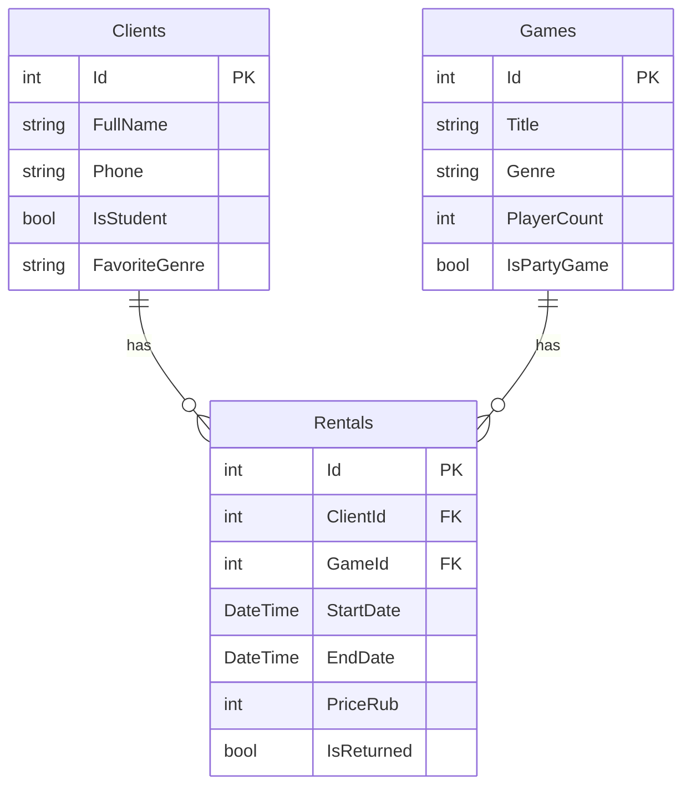

# PickDiceCool

Приложение для учета аренды настольных игр.

## Автор

Шурупов Константин 11/2-РПО-25/1

## О проекте

Тема - прокат настольных игр. Мое место называется PickDiceCool. Это маленькое место, где можно взять настольную игру на нужное количество дней. Приложение нужно для учета клиентов, игр и аренды. Фишка места в том, что здесь есть разного рода игры и подобрать игру по количеству игроков легко и быстро.

## База

## Таблицы

### Clients

Здесь хранятся данные о клиентах проката.

| Поле | Тип | Обязательное | Описание |
|---|---|---|---|
| Id | int | да | Первичный ключ клиента |
| FullName | string | да | Имя и фамилия клиента |
| Phone | string | да | Номер телефона |
| IsStudent | bool | да | Является ли клиент студентом |
| FavoriteGenre | string | нет | Любимый жанр настольных игр |

### Games

Здесь хранятся данные о настольных играх.

| Поле | Тип | Обязательное | Описание |
|---|---|---|---|
| Id | int | да | Первичный ключ игры |
| Title | string | да | Название игры |
| Genre | string | да | Жанр игры |
| PlayerCount | int | да | Рекомендуемое количество игроков |
| IsPartyGame | bool | да | Является ли игра пати-игрой |

### Rentals

Здесь хранятся факты аренды игр клиентами.

| Поле | Тип | Обязательное | Описание |
|---|---|---|---|
| Id | int | да | Первичный ключ аренды |
| ClientId | int | да | Внешний ключ на клиента |
| GameId | int | да | Внешний ключ на игру |
| StartDate | DateTime | да | Дата начала аренды |
| EndDate | DateTime | нет | Дата завершения аренды |
| PriceRub | int | да | Стоимость аренды в рублях |
| IsReturned | bool | да | Возвращена ли игра |

## Связи

Rentals связана с Clients по полю ClientId. Rentals связана с Games по полю GameId. Один клиент может брать много игр, и одну игру могут брать разные клиенты в разное время, те и того получается связь многие-ко-многим через Rentals между Clients и Games.