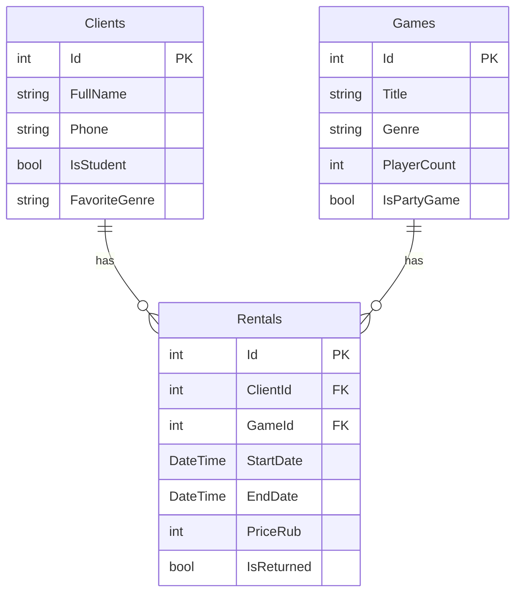

# PickDiceCool

Приложение для учета аренды настольных игр.

## Автор

Шурупов Константин 11/2-РПО-25/1

## О проекте

Тема - прокат настольных игр. Мое место называется PickDiceCool. Это маленькое место, где можно взять настольную игру на нужное количество дней. Приложение нужно для учета клиентов, игр и аренды. Фишка места в том, что здесь есть разного рода игры и подобрать игру по количеству игроков легко и быстро.

## База

